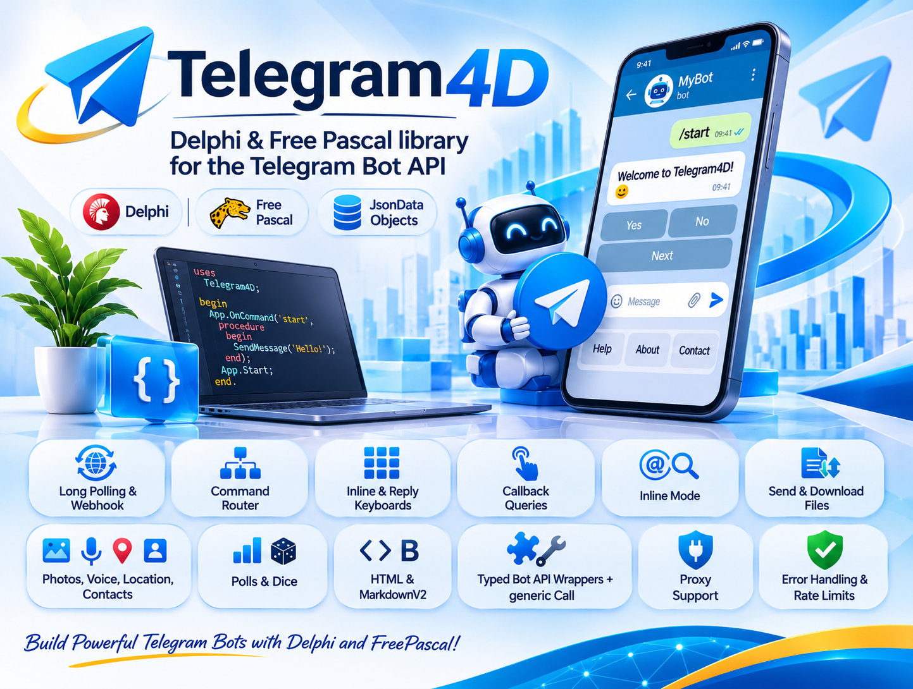

<div align="center">
  
</div>

# Telegram4D

A Delphi and Free Pascal library for the **Telegram Bot API**, written against **Bot API 10.3** (library version `0.1.0`).

Telegram4D gives you a small, readable API for the everyday work (commands, inline keyboards, files, polls, inline mode, webhooks) and a generic `Call` for every other Bot API method, so you are never blocked by a missing wrapper.

```pascal
App := TTelegramApp.Create(Token);
App.OnCommand('start', procedure(Ctx: TTgContext) begin Ctx.Reply('Hello!'); end);
App.Start;   // long polling in a background thread
```

**License:** [Apache License 2.0](LICENSE). Free for personal and commercial use; attribution is required (see [License](#license)).

---

## Required dependency: JsonDataObjects

> **Telegram4D depends on [JsonDataObjects](https://github.com/ahausladen/JsonDataObjects) by Andreas Hausladen. It is mandatory: the library does not compile without it, and it is not bundled in this repository.**

You must download it yourself and add its folder to your compiler's search path (see [Installation](#installation)). Please check its license before shipping it with your product.

How the dependency is used:

- All JSON parsing and generation goes through JsonDataObjects (`TJsonObject`, `TJsonArray`, `TJsonBaseObject`).
- Only **one** unit refers to it by name: `Telegram4D.JSON` (a thin indirection that re-exports the three types). Every other Telegram4D unit takes its JSON types from there.
- The response types in `Telegram4D.Types` are read-only views directly on top of `TJsonObject`; the request builder (`Telegram4D.Params`) and the keyboard builders (`Telegram4D.Markup`) build `TJsonObject` / `TJsonArray` values as well.
- You normally never touch JsonDataObjects yourself, but `Bot.Call(...)` returns a `TJsonObject` root and `TTgObject.Raw` exposes the underlying object when you need a field the library has no accessor for.

**Free Pascal note:** the original JsonDataObjects targets Delphi. To use Telegram4D with Free Pascal you need a version of JsonDataObjects that compiles with FPC, or a small adapter providing the same API surface. Because the dependency is isolated in `Telegram4D.JSON`, replacing the JSON backend for FPC means changing that single unit.

---

## Features

- **Receiving updates:** long polling in a background thread, or webhook mode (you pass the request body to `HandleWebhook`; the library has no HTTP server of its own).
- **Router:** `OnCommand`, `OnText`, `OnMessage`, `OnCallback`, `OnCallbackPrefix`, `OnInlineQuery`, `OnUpdateKind`, `OnAnyUpdate`. First match wins. In Delphi every registration also accepts an anonymous method.
- **Context object (`TTgContext`):** `Reply`, `ReplyHtml`, `ReplyTo`, `Answer`, `EditText`, `Typing`, plus the current message, chat, user and update.
- **Fluent keyboards:** inline keyboards, reply keyboards (contact and location requests), remove keyboard, force reply. Interface based, nothing to free.
- **Sending:** text, photo, document, video, audio, voice, animation, video note, sticker, location, contact, poll, dice, chat actions, forward and copy.
- **Files:** send by `file_id` or URL, upload a local file, upload from a stream, download files users send.
- **Editing and moderation:** edit text, caption and markup, delete, pin and unpin, ban, unban, leave, approve or decline join requests, member lists.
- **Inline mode, callbacks, payments:** `AnswerInlineQuery`, `AnswerCallbackQuery`, `AnswerPreCheckoutQuery`.
- **Any Bot API method:** `Call`, `CallBool`, `CallMessage`, `CallObject`, `CallList`.
- **Forward compatible types:** response classes are views over the JSON, so fields added by future Bot API versions are reachable immediately through `Raw`, `HasField` and `FieldAsString`.
- **Transport:** built-in HTTP client for Delphi (`System.Net.HttpClient`) and Free Pascal (`fphttpclient`), HTTP proxy support, custom Bot API server URL, and a pluggable `ITgHttpClient` (for example to use RESTRequest4Delphi).
- **Robustness:** typed exceptions, automatic retry on HTTP 429 (rate limit), polling that survives handler exceptions and network errors, webhook secret token check.
- **Helpers:** `HtmlEscape`, `MarkdownV2Escape`, `MentionHtml`.

---

## Requirements

| Item | Delphi | Free Pascal |
|---|---|---|
| Compiler | Delphi 10.3 or newer | FPC 3.2 or newer (Delphi mode) |
| JSON | **JsonDataObjects** (required) | a JsonDataObjects version that compiles with FPC (required) |
| HTTP | `System.Net.HttpClient` (included in Delphi) | `fphttpclient` + `opensslsockets` (included in FPC); OpenSSL libraries installed for HTTPS |
| Threads | included | on Unix `cthreads` must be the first unit of your program |

No third-party package other than JsonDataObjects is needed.

---

## Installation

1. **Get JsonDataObjects:** clone or download <https://github.com/ahausladen/JsonDataObjects> (the unit you need is `JsonDataObjects.pas`).
2. **Get Telegram4D:** copy this repository, or just its `Source` folder.
3. **Add two folders to the search path** of your project:
   - Delphi: *Project > Options > Building > Delphi Compiler > Search path*
   - Lazarus: *Project > Project Options > Compiler Options > Paths > Other unit files*
   - the Telegram4D `Source` folder
   - the folder that contains `JsonDataObjects.pas`
4. Add the Telegram4D units you use to your `uses` clause. There is no package (`.dpk` / `.lpk`) to install.
5. Create a bot with **@BotFather** in Telegram (`/newbot`) and keep the token. Do not hard-code it; read it from an environment variable or a settings file.

---

## A small example

A complete console bot: a `/start` command with an inline keyboard, a callback handler that edits the message, and an echo for plain text.

```pascal
program HelloBot;

{$APPTYPE CONSOLE}

uses
  SysUtils,
  Telegram4D.Types,    // TTgContext, TTgMessage, ...
  Telegram4D.Markup,   // InlineKeyboard
  Telegram4D.App;      // TTelegramApp

var
  App: TTelegramApp;
begin
  App := TTelegramApp.Create(GetEnvironmentVariable('TELEGRAM_BOT_TOKEN'));
  try
    // /start -> greeting with two buttons
    App.OnCommand('start',
      procedure(Ctx: TTgContext)
      begin
        Ctx.Reply('Hello ' + Ctx.User.FirstName + '! Do you like Delphi?',
          InlineKeyboard
            .Button('Yes', 'vote:yes').Button('No', 'vote:no')
            .Row
            .Url('Bot API docs', 'https://core.telegram.org/bots/api'));
      end);

    // button press -> stop the spinner and edit the original message
    App.OnCallbackPrefix('vote:',
      procedure(Ctx: TTgContext)
      begin
        Ctx.Answer('Thanks!');
        Ctx.EditText('You answered: ' + Copy(Ctx.CallbackData, 6, MaxInt));
      end);

    // any other text -> echo as a reply
    App.OnText(
      procedure(Ctx: TTgContext)
      begin
        Ctx.ReplyTo('You said: ' + Ctx.Text);
      end);

    App.Start;                 // long polling in a background thread
    Writeln('Running. Press Enter to stop.');
    Readln;
    App.Stop;
  finally
    App.Free;
  end;
end.
```

Free Pascal (and Delphi, if you prefer) uses methods as handlers:

```pascal
type
  THandlers = class
    procedure Start(Sender: TObject; Ctx: TTgContext);
  end;

procedure THandlers.Start(Sender: TObject; Ctx: TTgContext);
begin
  Ctx.Reply('Hello!');
end;

// ...
App.OnCommand('start', H.Start);
```

### More snippets

Send without the router:

```pascal
Bot := TTelegramBot.New(Token);
try
  Bot.SendText(123456789, 'Hello');                  // numeric chat id
  Bot.SendText('@mychannel', 'New post');            // channel username

  Bot.SendDocument(ChatId, TTgInputFile.FromPath('C:\Reports\a.pdf'), 'Monthly report').Free;
finally
  Bot.Free;
end;
```

Any Bot API method, even without a wrapper:

```pascal
Bot.CallBool('setChatTitle',
  NewParams.AddChat('chat_id', ChatId).Add('title', 'New title'));
```

Reading what the user sent (optional parts are `nil` when absent):

```pascal
Msg := Ctx.Message;
if (Msg <> nil) and (Msg.Document <> nil) then
  Bot.DownloadFileTo(Msg.Document.FileId, 'C:\Downloads\' + Msg.Document.FileName);
```

Behind a proxy (Telegram blocked on your network):

```pascal
App := TTelegramApp.Create(Token, '127.0.0.1', 10809);
```

---

## Project layout

```
Telegram4D/
  Source/                 library units
  Demo/
    Delphi/               complete Delphi demo      (Showcase.dpr + Showcase.Handlers.pas)
    FreePascal/           complete Free Pascal demo (Showcase.lpr + Showcase.Handlers.pas)
  Docs/                   documentation
  LICENSE                 Apache License 2.0
  NOTICE                  attribution notice (keep it when you redistribute)
```

### Units

| Unit | Purpose |
|---|---|
| `Telegram4D.JSON` | the only unit that names **JsonDataObjects**; re-exports `TJsonObject`, `TJsonArray`, `TJsonBaseObject` |
| `Telegram4D.Http` | `ITgHttpClient` and the default implementation; proxy and multipart file upload |
| `Telegram4D.Params` | `NewParams` request builder, `TTgChatId`, `TTgInputFile` |
| `Telegram4D.Markup` | fluent inline and reply keyboards |
| `Telegram4D.Types` | read-only views over JSON: Update, Message, User, Chat, CallbackQuery, ... |
| `Telegram4D.Bot` | `TTelegramBot`: typed methods plus the generic `Call` family |
| `Telegram4D.App` | `TTelegramApp`: router, long polling, webhook entry point, `TTgContext` |
| `Telegram4D.Utils` | `HtmlEscape`, `MarkdownV2Escape`, `MentionHtml` |
| `Telegram4D.Consts` | version constants, parse modes, chat actions, chat types, member statuses |
| `Telegram4D.Errors` | `ETelegramApiError`, `ETelegramNetworkError`, `ETelegram4D` |

Dependency direction: `App` -> `Bot` -> (`Params`, `Markup`, `Types`) -> `Http` / `JSON`.

---

## Things worth knowing before you start

- **Memory ownership.** Objects returned by `Send*`, `Get*` and `Call*` (such as `TTgMessage`) must be freed by you. Sub-objects (`Msg.From`, `Msg.Chat`, ...) belong to their parent. Keyboards and `ITgParams` are interfaces and free themselves. `SendText` and the `Ctx.*` helpers return nothing to free.
- **Optional fields are `nil`.** Always check `Assigned` before using `Msg.From`, `Msg.ReplyToMessage`, `CallbackQuery.Message`, and similar.
- **Route order matters.** The first matching route wins, so register commands and callbacks first and generic routes (`OnText`, `OnMessage`, `OnAnyUpdate`) last.
- **Handlers run sequentially** in the polling thread. Keep them short, or set `App.SyncDispatch := True` to run them in the main thread (needs a message loop).
- **Never call `App.Stop` from inside a handler**; set a flag and let the main thread stop the app (the demo shows how).
- **Escape user text** with `HtmlEscape` / `MarkdownV2Escape` when you use `ParseMode`, otherwise Telegram rejects the message.
- **Limits of the cloud Bot API:** 50 MB per upload, 20 MB per download. Uploads are buffered in memory.

---

## Demo

`Demo/Delphi` and `Demo/FreePascal` contain a complete showcase bot (more than 20 commands: pagination, counters, reply keyboards, files, polls, dice, inline mode, chat member updates, error handling, raw JSON, admin-only command). Both folders use the same `Showcase.Handlers` unit. Set `TELEGRAM_BOT_TOKEN` (and optionally `TELEGRAM_ADMIN_ID`), add the search paths, build and run. Details: [Docs/05-Showcase-Demo.md](Docs/05-Showcase-Demo.md).

---

## Documentation

1. [Getting Started](Docs/01-GettingStarted.md): installation, token, first bot, proxy
2. [Architecture](Docs/02-Architecture.md): layers, memory ownership, threading, router, errors
3. [Reference](Docs/03-Reference.md): all classes and methods
4. [Cookbook](Docs/04-Cookbook.md): webhook, files, methods without a wrapper, custom HTTP client, troubleshooting
5. [Complete Demo](Docs/05-Showcase-Demo.md): how to run it and the feature list

---

## License

Telegram4D is released under the **Apache License, Version 2.0**. The full text is in the [LICENSE](LICENSE) file and the attribution notice is in [NOTICE](NOTICE).

In short, you may use, modify and distribute Telegram4D in personal, open source and commercial projects, including closed-source applications, under these conditions:

- **Keep the attribution.** When you redistribute the source code or a modified version, keep the copyright notices, include a copy of the license, and keep the contents of the `NOTICE` file with your distribution (in a `NOTICE` file, in your documentation, or in an about screen of your product).
- **Mark your changes.** Files you modified must carry a prominent notice that you changed them.
- **No warranty.** The software is provided "AS IS", and the authors are not liable for damages arising from its use.
- **Patent grant.** Contributors grant you a license to the patents their contributions necessarily infringe; that grant ends if you start patent litigation over the Work.
- **Contributions.** Unless you state otherwise, any contribution you submit for inclusion in this project is licensed under the same Apache 2.0 terms.
- **Names and trademarks.** The license does not grant the right to use the author's name or the project name to endorse derived products.

Third-party software is licensed separately:

- **JsonDataObjects** (required dependency) is **not** included in this repository and has its own license; read it at <https://github.com/ahausladen/JsonDataObjects> before you ship it with your product.
- "Telegram" is a trademark of Telegram Messenger Inc. Telegram4D is an unofficial library and is not affiliated with, endorsed by, or sponsored by Telegram.

## Author

Created and maintained by **Shaahin Ashayeri** ([@DelphiMan68](https://github.com/DelphiMan68)). If you use Telegram4D in a project, a mention or a link back to this repository is always appreciated.

---

## Status and limitations

- This is an **early version (0.1.0)**. It has **not yet been compiled or tested against a real compiler or the live Telegram API**. Expect small compile fixes on first build.
- Typed wrappers cover the common methods only. The Bot API has more than 180 methods; the rest are available through `Bot.Call` and friends.
- Typed response classes cover the common objects (update, message, user, chat, callback and inline queries, files, chat members, webhook info). Everything else is reachable through `Raw`.
- Free Pascal support depends on a JsonDataObjects version that compiles with FPC (see [Required dependency](#required-dependency-jsondataobjects)).
- No HTTP server is included for webhooks; plug in Indy, mORMot, Horse or any other server and call `App.HandleWebhook`.
